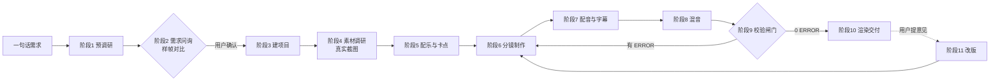

# promo-forge 工作规范

> 这是本仓库的核心文件。AI 编程工具（Claude Code / Cursor / Codex / Gemini CLI 等）打开本目录后，
> 必须**先把本文件从头读到尾**，再按下面的阶段推进。各阶段的详细方法在 `references/`，按需读取。

## 0. 这个仓库是什么

把「做一支能发出去的竖屏产品宣传片」这件事，写成 AI 可以照着执行的规范（本文件）+ 一个 Remotion
工程模板（`template/`）+ 一组可独立运行的脚本（`template/scripts/`）。

交付物：一支 **1080×1920 的竖屏 MP4**（首选）、可选 1920×1080 横版，外加一个可在线播放的网页版。

目标形态是 **30~60 秒、能被算法推荐、能被人看完** 的短视频，不是企业形象片。默认零付费：
配音用免费的 edge-tts，配乐用免费可商用曲库 + 本地节拍分析，渲染用 Remotion（个人与 3 人以内团队免费）。

### 四条总原则

1. **真实产品才是主角。** AI 画的图和代码画的图形只负责包装、转场和留白；功能展示必须是真实界面截图或真实作品图。
2. **一切审美判断都要落成可测量的数字。** AI 听不到声音、看不到画面对不对味，所以把要求写成秒数、dB、LUFS、
   像素、相似度，交给脚本判定，而不是交给"感觉"。
3. **需要人拍板的只有三类事**：需求确认、试听声音、只有用户能核实的事实。其余全自动。
4. **禁止套模板。** 风格要从产品的受众和调性推导出来，每个项目都要出样帧给用户挑，不允许所有产品都做成同一套深色科技风。

## 1. 两种用法与路径约定

| 用法 | `<工具目录>` | `<工作区>` | `<输出目录>` |
| --- | --- | --- | --- |
| 克隆仓库 | 本仓库根目录 | 本仓库根目录 | `outputs/<slug>/` |
| 安装成 Skill | `SKILL.md` 所在目录 | 用户当前项目根目录 | `<工作区>/宣传片/<slug>/` |

- `<slug>` 是项目短名，全小写 + 连字符，例如 `acme-app`。一个 slug 对应一个目录，永不混用。
- 新项目 = 复制 `<工具目录>/template/` 到 `<输出目录>`，再在副本里改。**永远不要改 `<工具目录>/template/` 本体**。
- Skill 用法下，提醒用户把 `<工作区>/宣传片/` 加进 `.gitignore`（工程文件可能几百 MB）。

## 2. 目录结构

```text
promo-forge/
├── AGENTS.md            # 本文件：工作规范（唯一权威）
├── SKILL.md             # 安装成 Agent Skill 时的入口
├── CLAUDE.md            # 让 Claude Code 也读 AGENTS.md
├── README.md            # 给人看的说明
├── references/          # 各阶段方法论（需求问询/风格方向/素材与截图/配乐与卡点/配音与字幕/校验清单/踩坑记录/案例复盘）
├── template/            # 复制到输出目录的工程模板
└── outputs/             # 克隆用法下的成片目录（git 忽略）
```

每个输出目录里除视频外，还必须有：

- `需求确认.md`：用户拍板的每一项决定 + 每一轮修改意见（原文）与处理方式。
- `调研笔记.md`：每个事实、每张素材、每首歌的出处与授权。
- `timing.json`：**整支片子的唯一事实来源**（见第 5 节）。
- `out/stills/`、`out/check-*.jpg`：校验用截图与联系表。

## 3. 流程总览



### 阶段 0 · 环境体检

```bash
python template/scripts/doctor.py      # 只检查、不安装；退出码 1 表示缺东西
```

缺什么就按脚本给出的命令装什么，装完重跑一次到没有 MISSING 再开工。没有 ffmpeg 不要往下走。

### 阶段 1 · 预调研（不打扰用户）

先用现有信息把能查的查完：产品官网/仓库 README/应用商店页/社媒主页。产出一页纸的初步结论：
它解决什么问题、谁在用、最值得炫耀的 3 个点、有没有现成的界面截图或视频。

### 阶段 2 · 需求问询（**唯一强制卡点**）

一轮 5~8 题、最多两轮问完，每题**首项必须是带理由的推荐项**，最后一题永远是"还有别的偏好吗"。
必问项：竖屏还是横版（默认竖屏 9:16）、时长（默认 **45 秒 ±10**）、发布平台、目标受众、
风格方向、开场方式、配音音色、素材来源与版权边界。

同时给出 **3~4 个差异明显的风格方向，每个方向画一张同尺寸样帧**（用 AI 绘图或代码绘制），
让用户直观看"这个风格用在我的产品上是什么样"。方法见 `references/风格方向.md`。

把结论写进 `<输出目录>/需求确认.md`，**等用户明确说"准确，开始制作"之后才允许进入阶段 3**。

### 阶段 3 · 建项目

```bash
cp -r template <输出目录>
cd <输出目录>
pnpm install            # 没装 pnpm 就 npm install（首次会下载 Remotion 依赖）
python scripts/doctor.py               # 副本内再体检一次
python scripts/audit.py init           # 建决策/成本账本 decisions.json（默认预算 0 元 = 零付费路线）
```

账本记"谁拍板、拍板了什么、花了多少钱、用没用付费服务"：默认 0 元预算即零付费。
`audit.py init` 只建一个 0 元骨架；**需求确认（`user_requirement`）是必填项**，建完账本还要补一条：

```bash
python scripts/audit.py init
python scripts/audit.py append --kind user_requirement --decision "确认需求与风格"
```

不补的话 `audit.py validate` / `check_assets.py` / `check_video.py` 都会报 ERROR。启用 ElevenLabs 等
付费服务要逐项记账并写清服务名（`--cost 5 --paid-service ElevenLabs`；**花了钱却没写服务名 = ERROR**），
累计金额超过预算（`PROMO_BUDGET_CNY` 或账本里的 `budget_limit_cny`）会被闸门拦下。试听声音
（`user_audio_review`）与只有用户能核实的事实（`user_fact_check`）属于**按项目条件校验**：有配音才记试听，
涉及客户数据/线下事实才记核实，不涉及时不强制（不把"没校验"写成"已校验"）。
`decisions.json` 和 `需求确认.md` 一样属于项目交付物，跟项目目录一起走。存量项目（账本出现之前建的）
没有 `decisions.json` 时，两个 check 脚本只报 WARN 并提示补跑 `audit.py init`，不会直接把老项目打红。

想让片子在任何机器上都不缺字，装完依赖跑一次字体子集化（把片子里真正用到的字内嵌进工程）：

```bash
python scripts/fonts.py subset     # 生成 public/fonts/promo-subset-*.ttf，并把 fonts.json 指过去
python scripts/fonts.py check      # 确认 0 缺字；改了文案或加了场景之后要重跑
```

子集字体是**按当前文案与场景源码生成的**（示例工程约 341 字、300 KB 左右），改了文字就要重跑，
否则新字会变成方块 —— `check_assets.py` / `fonts.py check` 会把缺字拦下来。
**子集字体不进版本库**（字体授权 + 体积）：克隆或复制工程后先跑一次 `subset`；不跑也能渲
（渲染侧会自动回退系统字体栈），只是换到没装中文字体的机器上会缺字。

复制后立刻：改 `src/timing.json` 的 `slug/title/aspect/duration/scenes`；`src/scenes/` 里的
`Hook / Demo / Proof / Cta` 是可直接运行的示例场景（零外部素材也能渲出画面），照着它们写自己的场景，
不需要的示例文件可以删掉，记得同步 `src/scenes/index.ts` 的注册表。

### 阶段 4 · 素材调研与真实截图

- 优先级：**用户提供的一手素材 > 真实页面截图 > AI 生成图 > 网络图片**。用到的每张图都要记进 `调研笔记.md`（来源 + 授权）。
- 真实界面截图用本仓库脚本，`--factor 2` 出 2 倍图（1080 宽显示 → 2160 像素）；不要用 AI 工具自带浏览器的截图功能，
  它们通常只有 1 倍分辨率，放进视频就是糊的。
- 需要登录的页面用 `--login` 弹一个真实窗口让用户登录一次，登录态存 `out/.browser-profile/`。
- **硬性配额：每个功能段落至少 1 张真实截图；片长 ≤45 秒时全片真实素材 ≥6 张、>45 秒时 ≥8 张；
  必须有一段由 ≥6 张真实作品组成的快切蒙太奇。** 数量不够就先补素材，不要用 AI 图凑数。

### 阶段 5 · 配乐与卡点

- 免费路线：从免费可商用曲库取 1~3 首候选放进 `audio-src/music/`，用 `music.py analyze/grid/bars` 分析出
  BPM、beat、bar、downbeat、drop 和逐小节能量；写回 `timing.json` 的 `music.beat/bar/drop/offset`。
- 音乐与画面必须对齐到 beat 或 bar：**`offset = drop − downbeat_abs`，其中 `downbeat_abs = --from + downbeat`**
  （**爆发时刻 − 重拍时刻**；`music.py grid` 报的 `downbeat` 是**相对分析区间起点**的，`--from 0` 时两者相同，
  用 `--from` 截过一段就必须加回去，否则写回 `timing.json` 的 offset 会整整差一个 `--from`；
  正负号含义与三种典型情形见 `references/配乐与卡点.md`）。
- **硬性要求：全片 ≥2 次能量爆发；最晚在第 4 秒完成第一次爆发；节拍一致性 ≥0.9；候选统一到 -14 LUFS 后再给用户试听。**
- 试听必须交给用户：把候选剪成同样的 15 秒片段，叠上人声给用户听，让他选（AI 听不到声音，禁止自己拍板）。

### 阶段 6 · 分镜制作

- 一个场景 = 一个组件，组件自己按 `timing.json` 的窗口判断显示与否，窗口外必须 `return null`。
- **时间基准只有两套，混用必翻车**：`timing.json` 里的 `scenes[].start/end`、`voice.lines[].at` 是**全片绝对秒**；场景组件里的 `t = useSceneTime(name)` 是**本场景相对秒**（Promo 的 `<Sequence>` 已经减掉场景起点）。所以在场景里取卡点一律用 `useSceneBeat("<场景名>")`（`const beat = useSceneBeat("proof")`；`useBeat("<场景名>")` 是同一条路径的另一个名字，**两者都必须传场景名**——零参调用会直接编译失败，因为旧版零参 `useBeat()` 的 start 恒为 0，`at/barAt/snap` 返回的是绝对秒，正是下面要警告的陷阱）：`beat.now / beat.at(i) / beat.barAt(i) / beat.snap(t, unit)` 全是**场景相对秒**（`energy/phase/onBeat` 也接受相对秒），要绝对秒就显式取 `beat.abs`。把 `snap()` / `beatAt()` 返回的绝对秒直接和 `t` 比大小，症状是**整场只剩字幕、画面全黑且没有任何报错**（示例模板第一版真的这么翻车过；旧版零参 `useBeat()` 已改为强制签名，不传场景名编译不过）。
- 所有画面尺寸用相对单位（`useVideoConfig()` 的宽高比、百分比），保证同一套场景在 9:16 与 16:9 下都不破版。
- 遵循第 4 节的节奏底线与密度要求；每个场景做完用 `npm run stills -- --scenes` 出图自查。

### 阶段 7 · 配音与字幕

```bash
python scripts/tts.py all        # 免费 edge-tts（默认）；--engine eleven 走 ElevenLabs（可选）
python scripts/tts.py audit      # 检查每句时长是否落在窗口内、有没有尾部拖音
```

- 旁白稿写进 `timing.json` 的 `voice.lines`，每句带 `id/scene/at/text`。语速按 **5.5~6.5 字/秒** 写，
  窗口 = 该场景可用时长；脚本会自动切静音、必要时最多加速 12%，并把结果写进 `audio-src/vo/report.json`。
- 字数超窗口的句子必须**改稿**而不是硬压：`tts.py audit` 报 `TOO_LONG` 就回去删字。
- 字幕：竖屏单行 ≤13 字、最多 2 行，屏上大字**最多比旁白早 1.5 秒**出现；停留时长 ≥ `字数 / 6 + 0.35` 秒
  （配音 5.5~6.5 字/秒，**字幕必须活到人声读完**，否则句尾还在念、字幕已经消失）。模板组件取
  `max(字数/8+0.4, 字数/6+0.35)`，并在场景结束前 0.15 秒收掉，避免和下一场景的字幕叠在一起。
- 字幕字号由脚本按安全区换算，**不许手写死**：`max(12, min(round(画布高 × 0.038), floor((画布宽 − 左右留白) / captions.maxChars)))`。
  竖屏 1080×1920 时 = min(73, 864/13) = **66px**；只按高度算的 73px 会让 13 个全角字（949px）越过
  右侧 14% 留白，侵入平台互动按钮区。**画面内 `<Caption>` 与硬字幕现在用同一个公式**：`src/lib/theme.ts` 的
  `captionFontSize()` / `captionSideInsets()`（左右按 6% / 14% 收边）↔ `subtitles.py` 的 `FONT_SCALE = 0.038` / `SAFE_LEFT` / `SAFE_RIGHT`，
  改一边必须同步另一边（模板已用 4 组画布/字数对账）。
- **ASS 的 `Fontsize` 是行高、不是 em**：libass 用字体自己的 `(hhea.ascent − hhea.descent)/unitsPerEm` 做归一，
  同一个 `Fontsize` 在不同字体上实际字面大小不同 —— 微软雅黑该比值 ≈1.32（只按 `Fontsize` 的 ≈0.758 em），
  SimHei / SimSun ≈1.0。所以上面公式算出的 66px 是 **em 像素**，`subtitles.py ass` / `burn` 写 ASS 时会按字体
  度量自动换算（微软雅黑：em 66px → `Fontsize≈87.1`，烧进画面才和 `<Caption>` 一样大）；`ass --fontsize`
  传的也是 em 像素口径。别直接把 66 抄进 ASS（不换算时微软雅黑上会小约 24% 且不报错，见 `references/踩坑记录.md` #49）。
- 断行**不许拆词**：优先标点/语义边界，`URL`/英文单词/数字整段不可拆，装不下就整词下移；只有单个词
  本身比整行还宽才从中间硬切并 WARN。因此一句话若放不进 2 行，`subtitles.py srt/ass/burn` 会**直接
  ERROR**（不是静默多一行）：回去删字，或调大 `captions.maxChars`、调小字号对应的画面文案。
  **画面内字幕**的折行同样按这套规则走 `src/lib/captionText.ts`（`subtitles.py::_fold_text` 的 TS 移植，
  两组实现用 9 个句子对账过），改折行要两边一起改。
- ASS 文本里的 `{ } \N \n \h` 是语义字符：拼装字幕一律走 `subtitles._escape_ass_text()`，不要图省事自己
  把 `\` 换成 `\\`（实测无效，第二个反斜杠 + 字母会重新组成转义），细节见 `references/踩坑记录.md` #43。
- 字幕有两条路：**画面内字幕**（`<Caption>` 组件，跟着画面一起渲染）和**字幕文件 / 硬字幕**
  （`scripts/subtitles.py`，给平台上传用，或平台不认软字幕时烧进画面）：

```bash
python scripts/subtitles.py srt                  # out/subtitles/zh.srt（给平台或剪辑软件）
python scripts/subtitles.py ass                  # out/subtitles/zh.ass（样式与画面一致）
npm run render:1080:nosubs                       # 烧硬字幕前：先渲一版不带画面字幕的成片
python scripts/subtitles.py burn out/final-1080p-nosubs.mp4 -o out/final-1080p-hard.mp4
```

  **烧硬字幕前必须先渲 nosubs 版**：画面里的 `<Caption>` 和烧进去的 ASS 都由 `captions.bottom` 定位，
  直接烧会叠成两行糊字（`burn` 在 `captions.enabled=true` 时也会 WARN 提醒）。
  硬字幕用**系统字体**渲染（`fonts.json` 的 `stack`），不用子集字体：字幕改一个字就可能超出子集范围，
  那会静默变成方块；要改字幕就改 `voice.lines[].text` 并重跑 `tts.py`。

**配音与字幕对得上要机器验证**：`python scripts/transcript_check.py transcript.txt` 用用户提供的逐句转写（txt 每行一句，或 SRT 自动识别）反查 `timing.json` 的 `voice.lines`：默认**任一语音行没对上就 ERROR**，相似度阈值 `--threshold`（默认 0.85）、字符覆盖率 `--min-coverage`（默认 1.0）可调；顺序错位、品牌名与网址错字（对标 STT 反查的「品牌名错一个字就失败」）也是 ERROR，多余转写行只 WARN。它不下载模型、不调付费 ASR，零依赖可离线。注意它是**反查口播与字幕文案是否一致**，不替代「人耳试听音色」那一步。

### 阶段 8 · 混音

```bash
python scripts/mix.py            # 生成 public/audio/music.wav（= timing.json 的 music.file）
python scripts/mix.py --env      # 打印成品响度包络，检查人声是否被音乐盖住
```

硬性要求：每句人声比该处音乐高 **≥6 dB**（脚本里的 `vo_margin`）；母带 **-14 LUFS / 真峰值 -1 dBFS**；
片头 0.3 秒淡入、片尾 0.6 秒淡出；除转场瞬间外不允许出现 ≥1.0 秒的空档。

**母带后量不到成品响度 = 混音失败**（闸门失效不等于通过）：`mix.py` 会用 ebur128 复测成品响度，测不到、
或偏离 -14 LUFS 超过 2 dB，都直接非零退出并打印 `ERROR`。这条需要**完整版 ffmpeg（含 ebur128 滤镜）**：
Remotion 自带的 compositor 精简构建没有 ebur128，会报「母带后响度复测失败」——这是环境限制，装完整 ffmpeg 再混。

**母带的两种模式会让「打印的余量」和「成片的余量」不一致**：逐句余量是在**母带前**总线上量的，
而 -14 LUFS / 真峰值 -1 dBFS 只允许 13 dB 的 PLR（真峰值 − 响度）。母带前真峰值贴着 0 dBFS
（PLR > 13 dB）时，ffmpeg 的 `loudnorm` 会静默回落成**动态**模式，母带不再是整体增益，成片余量
会比打印值低 1~2 dB（`mix.py` 会打印一条 WARN 说这件事）。
- **光降 `music.gain` 不一定管用**：峰值大多是人声总线顶上去的。实测（模板示例、真实 edge-tts 人声）
  `gain` 从 1.0 降到 0.6，母带前响度只从 -18.0 变成 -19.25 LUFS，PLR 仍是 19.2 dB。
- 真正管用的两条路：① 给母带前总线过一遍限制器，把真峰值压到 -6 dBFS 以下；
  ② 接受这 1~2 dB 误差，**按打印余量再留 2 dB**（打印 ≥8 dB 才当安全交付）。
- 别为了凑 PLR 去压人声本身：人声小了，闸门和实听都会先出问题。

### 阶段 9 · 校验闸门（**不许跳步**）

```bash
python scripts/check_assets.py                      # 渲染前：缺文件/图片过小/字体缺字/混音不存在 + 决策账本
python scripts/audit.py validate                    # 决策/成本账本：结构、人拍板三类事、付费记账、预算上限
npm run stills -- --scenes                          # 每场景抽 40% 与 80% 两帧
python scripts/media.py sheet out/stills --cols 4   # 拼成联系表
python scripts/frame_check.py                       # 静帧证据：帧数/尺寸/空白/场景覆盖（机器可验证「看过」）
python scripts/transcript_check.py transcript.txt   # 转写反查：漏念/错序/品牌错字（用户提供转写，替代 STT）
python scripts/check_video.py out/final-1080p.mp4   # 渲染后：规格/响度/空档/渲染日志报错 + 联系表 + 决策账本
python scripts/fonts.py check                       # 缺字（内嵌子集 / 系统字体都算）
python scripts/deliver.py check out/final-1080p.mp4 --platform all   # 平台预检 + 静帧证据 + 生成发布合规清单
python scripts/publish_check.py                     # 四平台发布前检查单（标题/话题/正文/时长/封面/安全区）
```

- **`check_assets.py` 与 `check_video.py` 必须 0 ERROR 才算通过**；WARN 要逐条说明为什么不影响交付。
- **决策与成本账本必须存在且 0 ERROR**：`audit.py validate` 或两个 check 脚本都会查 `decisions.json`——
  结构坏、缺「人拍板的需求确认」记录、付费服务没记账（含花了钱没写服务名）、累计金额超预算，都是 ERROR；
  存量项目缺账本只报 WARN 并提示 `audit.py init`。试听声音 / 只有用户能核实的事实是按项目条件校验项。
  零付费项目 `audit.py init` + `append --kind user_requirement` 后默认通过，不增加日常负担。
- **发布合规清单 0 ERROR 才好投平台**：`publish_check.py` 按抖音/快手/小红书/视频号分别查
  标题长度、话题数（越界 = ERROR）、正文长度、时长、封面数量与尺寸、字幕安全区；成片还要校验
  MP4 容器结构（`ftyp`/`moov`，文本假视频直接 ERROR；有 ffprobe 再验编码/时长/分辨率，没有则显式 WARN）。
  `deliver.py check` 通过后会自动生成 `publish/manifest.json`。它只出检查单，**绝不自动发布**
  （账号风控与平台合规由人负责）。
- 抽帧联系表**必须逐张看过**，对照 `references/校验清单.md` 的审图项打勾（构图、字幕安全区、截图清晰度、品牌名拼写）。
- **「看过画面」「配音与字幕对得上」要有机器证据**：`frame_check.py` 逐帧**完整解码** PNG（纯标准库，
  不依赖 Pillow）、按亮度方差判空白帧（默认阈值 6.0）、核对像素尺寸等于 `timing` 的 `width×height`、
  再用文件名时间戳（`stills.mjs` 的 `%06.2f` 命名）核对每个场景都有帧；`--json` 输出 `{ok, frames, problems}`
  给外部编排器，有 ERROR 非零退出。`transcript_check.py <用户提供的转写.txt|.srt>` 把「实际念出来的话」与
  `voice.lines`（或 `--ref srt` 用已生成字幕）逐行保序对齐：任一语音行漏配 / 相似度低于 `--threshold`（默认 0.85）/
  字符覆盖率低于 `--min-coverage`（默认 1.0）/ 顺序错位 / 品牌名与网址错字 = ERROR，多余转写行 = WARN。
  它不下载模型、不调付费 ASR（对标 STT 反查的零依赖替代）。`deliver.py check` 默认跑静帧证据闸门
  （没有 `out/stills` 只 WARN，`--no-frames` 可跳过）；`publish_check.py --frames <dir> --transcript <file>`
  可把两项证据并入发布检查单（显式传入才启用）。
- 渲染日志里出现 `cannot be decoded` / `Error:` / `failed to load` 一律按失败处理，即使渲染"成功结束"。
  另有 9 条**强失败信号**同享此判据，而且**优先于**「`0 errors` 自称零错误」的豁免（汇总行会跟真错误写在同一行）：
  `Unhandled exception` / `Command failed with exit code N`、`exited with code N`、`exit status N` /
  `Segmentation fault`、`core dumped` / `MODULE_NOT_FOUND`、`Cannot find module`、`Unable to resolve module`（依赖或路径真找不到）/
  `Invalid data found when processing input`、`Could not find codec parameters`（ffmpeg 读不了输入）/
  `chrome-headless-shell` 非零退出。判据实现见 `template/scripts/check_video.py` 的 `_RX_LOG_STRONG`。
- **超时按失败语义判、不按裸词判**：`TimeoutError` / `timed out` / `timeout … exceeded|expired|waiting|after|while|during`
  才算失败；配置回显 `Timeout: 30000 ms` 不算（`check_video.py` 的 `_RX_LOG_TIMEOUT`，R5-CV-02）。
- **日志编码**：不要用 PowerShell `>` 写日志（默认 UTF-16）；脚本会识别 UTF-16 BOM / 无 BOM 的 UTF-16 日志
  并打 WARN 说明（`_decode_log_bytes`），但仍推荐 `--log` 用 UTF-8（`... | Out-File -Encoding utf8 out/render.log`）。
- **空渲染日志 = ERROR**：日志文件存在但 0 字节 / 0 行等于没跑闸门（不是「没报错」），要重跑渲染并确认日志有内容；
  只有确实不需要检查时才显式加 `--no-log`（`check_video.py` 的 `check_render_log`）。
- **混合 / 非 UTF-8 日志也要扫报错词**：编码可疑（UTF-16、GBK 或混合编码）时脚本会 WARN 留痕，并额外按
  latin-1 兜底扫描 ASCII 报错词——UTF-16 / GBK 日志里的 `Error:` / `failed to load` / `cannot be decoded`
  同样拦得住（`_decode_log_bytes` + latin-1 兜底扫描）。
- **音轨必须覆盖全片**：有音轨但比视频短 >0.3 秒 = ERROR（片尾静音 silencedetect 只查音频流内部，查不到这段；
  `check_video.py` 的 `AUDIO_SHORTER_TOLERANCE_S`）；渲染命令别用 `-shortest` 截音轨。
- **常驻 >1 条音轨 = WARN**：只有第一条音轨参与响度 / 空档 / 音轨时长检查，第二条起不参与；出现这条 WARN
  先确认不是混音文件被重复 mux（`check_video.py` 的 `check_spec` 音轨段）。
- **带 rotate 元数据的成片按「显示尺寸」判规格**：解码 / 播放会按 rotation 旋转，coded 尺寸与实际显示可能相反；
  脚本会 WARN 并按显示尺寸判分辨率与画幅，逐场景抽帧和联系表也用显示尺寸（Remotion 正常产物不应带 rotate；
  确属横屏交付时用 `--expect` 显式声明，见 `check_video.py` 的 `check_spec` / `extract_frames`）。

### 阶段 10 · 渲染与交付

```bash
npm run render:preview     # 30fps 预览，先给人看结构
npm run render:1080        # 1080×1920 正式版
npm run render:4k          # --scale=2 出 2160×3840（平台会二压，非必要可跳过）
npm run web:build && npm run web:serve    # 网页播放版
```

**模板仓库不带音频**：`timing.json` 里 `music.file` 指向的文件是 `mix.py` 的产物（在 `.gitignore` 里）。
没跑过混音就渲染，模板会**自动跳过音轨、渲出一支无声片**（不会报错，见 `src/Promo.tsx` 的
`MUSIC_FILE_EXISTS`）—— 缺音轨由渲染前的 `check_assets.py`（ERROR: 混音文件）和渲染后的
`check_video.py`（ERROR: 无音轨）拦下来。**别把无声片当成品交出去。**

**投平台前再跑一次交付预检，并用脚本出候选封面**：

```bash
python scripts/deliver.py check out/final-1080p.mp4 --platform all
python scripts/deliver.py cover out/final-1080p.mp4 --title "每天记账要花十几分钟？"
python scripts/publish_check.py --strict    # 发布前最后一关：0 ERROR 才投；生成 publish/manifest.json
python scripts/publish_check.py --strict --frames out/stills --transcript transcript.txt   # 可选：把两项证据并入检查单
```

- `publish_check.py` 是**发布前检查单**，不是发布器：逐平台给标题/话题/正文/时长/封面/安全区的
  ERROR/WARN，清单落 `publish/manifest.json`（含每平台 `publishable` 结论与检查明细），
  **manifest 与退出码用同一份最终结果**——`--strict` 升级后的 WARN 会同时反映在
  `summary.errors/publishable` 与每个平台的 `publishable` 上，不会出现「summary 说不可发、平台说可发」。
  `--strict` 把 WARN 也当 ERROR；文案用 `publish/copy.json` 覆盖（标题/话题/正文），
  也可以用 `--title/--hashtags/--body` 直接传。**它不会登录任何平台、不会自动发布**。
- `--frames <静帧目录>` / `--transcript <转写文件>` 是**显式传入才启用**的可选证据闸门（不传时行为与以前完全一致，既有产物不会因为新增检查突然红）：`--frames` 把 `frame_check.py` 的帧覆盖/尺寸/空白结论并入检查单，`--transcript` 把转写反查结论并入（漏念/错序/品牌错字 = ERROR）；两者都写进 `publish/manifest.json` 的明细。

- `check` 按平台给硬限制与推荐值；**抖音、小红书的官方口径脚本抓不到**，那部分标「需人工确认」
  （只提示、不参与判定，不会因此刷 WARN）；第三方汇总口径才按 WARN 处理，交付时必须说清"需人工确认"；
  视频号的码率 / 画幅官方原文用的是「建议」，标「官方建议值（非硬限制）」只判 WARN，不算拒收门槛
  （视频号分辨率是「本项目规范」——AGENTS 的 1080×1920 交付要求，不是平台硬限制）。
- `cover` 出三张 1080×1920 候选封面 + 联系表：文字自动排进安全区、越界自动缩字号；
  重跑时会把上一轮本功能留下的 `cover-*.png` 与 `_{片子名}-frame-*.png` 先清掉（只删匹配到的文件，不动其它产物），
  避免旧候选混进交付目录；封面文字可能压住画面自带的字，脚本用亮像素比例粗判并提示换 `--position bottom|middle|top`，
  最终**必须逐张看图**再交（`references/校验清单.md` 的 B8）。
- 需要硬字幕时：先 `npm run render:1080:nosubs` 再 `subtitles.py burn`（见阶段 7），
  烧完的片子要塞进 `check_video.py` 复查一遍。

交付时告诉用户三件事：成片路径、网页版地址、以及"哪里还可以改、改一处要重做哪些步骤"。

网页版已加启动兜底：`web/main.tsx` 的 `<BootErrorBoundary>` + `getStaticFiles()` 返回 `undefined` 的守卫（R5-TPL-01）；
页面若显示「网页版加载失败」，先 `npm run web:build` 重新构建，再看浏览器 console（细节见 `references/踩坑记录.md` #46）。

### 阶段 11 · 改版

把用户的意见**原话**记进 `需求确认.md`，判断影响范围，只重做必要步骤：

| 改动 | 需要重做 |
| --- | --- |
| 只改字幕文案 | 场景组件 → 重新渲染（不动音频） |
| 只换配音音色 | `tts.py` → `mix.py` → 替换成片的音轨（画面不重渲） |
| 改配乐 | `music.py` 重新分析 → 更新 `timing.json` 的 beat/bar/drop → 场景卡点微调 → 重渲 |
| 只改发布文案 / 话题 / 封面 | `publish_check.py`（必要时 `deliver.py cover`）→ 重新生成 `publish/manifest.json`；不重渲 |
| 换风格 | 回到阶段 2 重出样帧 → 场景组件大改 → 全流程重跑 |

## 4. 节奏：底线与密度

**底线（保证看得清）**

| 项 | 数值 |
| --- | --- |
| 开场出钩子 | ≤2.0 秒内出现痛点或亮点 |
| 重点镜头 | ≥1.2 秒 |
| 快切镜头 | ≥0.5 秒 |
| 信息型场景 | ≥3.0 秒 |
| 网址 / CTA | ≥2.5 秒，且放在全片能量最高处 |
| 元素逐个出现 | 间隔 ≥0.25 秒，出齐后停留 ≥0.6 秒 |
| 同一镜头多个焦点 | 每个焦点 ≥1.2 秒 |

**密度（保证不拖沓）**

| 项 | 数值 |
| --- | --- |
| 新信息间隔 | 任意时刻往后 2.0 秒内必须有新信息 |
| 纯转场 / 飞镜 | ≤0.5 秒 |
| 同一版式 | 最多连用 2 次 |
| 单场景小节数 | ≤2 个（约 4 秒） |

竖屏安全区（相对画面高宽）：上 10%、下 18%、左 6%、右 14%（右侧留给平台互动按钮）。

**`timing.json` 的 `pace` 与上面这两张表的关系**：数值必须一致，但职责不同 ——
`pace.stagger`（0.25s）是**唯一被场景代码读走**的一项（`stagger(i, TIMING.pace.stagger)` 驱动"元素逐个出现"）；
`pace.minShot / keyShot / sceneMin / holdAfterReveal` 是**给人（和 AI）看的约束**：它们描述"镜头 / 焦点 / 场景"级别的判断，
渲染路径里没有消费者，也没有自动闸门会判 —— 写场景时照着做，验收靠阶段 9 的抽帧审图与 `references/校验清单.md`。
**不要为了让这些字段"有人读"而把它们接进动画**（那等于把审美判断伪装成机械判定），也**不要单独删掉那些字段**：
删字段必须连 `src/lib/timing.ts` 的 `Pace` 类型一起改，否则类型与数据对不上。

## 5. `src/timing.json` 字段契约（**整支片子唯一事实来源**）

TS 侧（Root / Promo / 场景 / 动画库）与 Python 侧（tts / mix / music / check_*）**都读这一个文件**，
禁止任何一端硬编码时长、帧率或音色。字段含义如下，改动必须同步本表。

```jsonc
{
  "slug": "acme-app",
  "title": "Acme 记账",
  "fps": 60,               // 必须有限正数且 0 < fps ≤ 240；字符串/布尔/0/负/NaN/Inf 都是 ERROR（check_assets.py 校验，R6-TPL-03）
  "width": 1080,          // 竖屏 1080×1920；横版改 1920×1080
  "height": 1920,
  "aspect": "9:16",       // "9:16" | "16:9"
  "duration": 45,         // 秒，必须等于最后一个场景的 end
  "music": {
    "file": "audio/music.wav",  // 相对 public/；混音脚本会写出这个文件。必须是 public/ 下的相对路径（绝对路径 / 盘符 / `..` 越界 / 含冒号或控制字符 = ERROR，R9-CA-04：mix.py 照这个路径写盘并自动建父目录）
    "source": "audio-src/music/track.mp3",
    "offset": 0.0,        // 视频时间 = 音乐时间 + offset
    "beat": 0.4615,       // 每拍秒数
    "bar": 1.846,         // 每小节秒数（通常 4 beat）
    "drop": 3.69,         // 第一次爆发的视频时间
    "gain": 0.6,             // 音乐床电平；人声余量不足先降它（PLR 过高多是人声峰值顶的，见阶段 8）。只在 mix.py 混音时生效，成片播放不要再乘一次
    "segments": [ { "at": 22.0, "from": 12.0, "to": 30.0 } ]  // 可选：剪接片段。结构由 check_assets 校验：必须是数组；每段是对象；at/from 是非负数字；给了 to 必须 from < to。at 超出片长的段由 mix.py 处理（摆不进片子会报错/跳过，不静默）
  },
  "scenes": [             // 必须按 start 升序、首尾相接、不留缝
    { "name": "hook",  "start": 0.0,  "end": 4.5,  "note": "痛点开场" },
    { "name": "demo",  "start": 4.5,  "end": 26.0, "note": "三个真实界面" },
    { "name": "proof", "start": 26.0, "end": 36.0, "note": "真实作品蒙太奇" },
    { "name": "cta",   "start": 36.0, "end": 45.0, "note": "品牌 + 网址" }
  ],
  "pace": { "minShot": 0.5, "keyShot": 1.2, "sceneMin": 3.0, "stagger": 0.25, "holdAfterReveal": 0.6 },
  "voice": {
    "engine": "edge",                  // "edge"（免费）| "eleven"（需 key）
    "voice": "zh-CN-YunxiNeural",
    "rate": "+8%",                     // edge-tts 语速；eleven 用 stability 等参数
    "settings": { "stability": 0.45, "similarity_boost": 0.75 },
    "rmsDb": -13.0,
    "duckDb": -9.0,
    "lines": [
      { "id": "01", "scene": "hook", "at": 0.6, "text": "每天记账要花十分钟？" }
    ]
  },
  "captions": { "enabled": true, "maxChars": 13, "maxLines": 2, "bottom": 0.18 },  // bottom/top 是画布高度比例：若存在必须是 0~1 的有限数，越界 ERROR（check_assets.py 校验，R6-TPL-03）
  "brand": { "name": "Acme", "url": "acme.com", "logo": "img/logo.png",
             "colors": { "bg": "#0B0B12", "fg": "#FFFFFF", "accent": "#33E1A1" } }
}
```

约定：`at`、`start`、`end`、`drop` 一律是**秒**（浮点）；`beat/bar` 是**秒**；帧数由脚本或组件用 `Math.round(秒 × fps)` 换算。
`voice.lines` 每句必须有 `id/scene/at/text`（缺字段、非对象行、`voice.lines` 不是数组都是 **ERROR**，由 `check_assets.py` 校验，不再默认 `at = 0`）。
`voice.lines` 的 `id` **必须唯一**（`tts.py` / `subtitles.py` / `check_assets.py` 三处都拦，R8-CA-02）：`id` 同时是 `audio-src/vo/<id>.mp3` 的文件名、`tts.py` 缓存键与 `audio-src/vo/report.json` 的索引；重复时后一句的配音会覆盖前一句，而字幕/混音仍按各自的 `text` 摆位 —— 成片里画面字幕与听到的话对不上，却全程不报错。
`voice.lines[].text` 必须是**非空字符串**（空串 / 纯空白 / 数字 = ERROR，R9-CA-01：text 是 tts.py 合成、subtitles.py 上屏、mix.py 算人声窗口的唯一来源）；`id` 还必须能当**安全文件名**（不含 `/ \ :` 等分隔符、不是 `.`/`..`、不是 Windows 保留名 CON/PRN/AUX/NUL/COM1-9/LPT1-9、不以点或空格结尾，R9-CA-03：它会拼成 `audio-src/vo/<id>.mp3` 并当 tts 缓存键）。
时间/尺寸字段必须写成 **JSON 数字**，写成字符串（如 `"4.5"`）一律 **ERROR**（R8-CA-01）：覆盖 `duration`、`width`/`height`、`scenes[].start/end`、`voice.lines[].at`、`music.beat/bar/drop/gain/offset`、`music.segments[].at/from/to`、`captions.maxChars/maxLines`。原因是 TS 侧对它们做 `+` 运算（`Scene.tsx` 的 `useAbsTime`、`Caption.tsx` 的 `captionUntil`、`beats.ts` 的 `musicToVideo`），字符串会拼成 `"4.50.15"` → 后续 `Number`/比较得 NaN，画面卡点与画面内字幕整段静默消失；`fps` / `captions.bottom` 早已按同一口径拦（R6-TPL-03），R8 把其余数值字段补齐。
`fps` 必须有限正数且 `0 < fps ≤ 240`：字符串（如 `"60"`）、布尔、0、负数、NaN、Inf 都是 **ERROR**。它是帧号换算（秒 × fps）和渲染命令 `--fps` 的直接输入，写错会一路带到渲染阶段才炸（`check_assets.py` 的 `check_timing_structure`，R6-TPL-03）。
`music.offset` 与 `music.drop` 是**必填**字段：缺失 / `null` / 空串都是 **ERROR**（R8-CA-05，`check_assets.py` 的 `check_music_fields`）。`src/lib/timing.ts` 的 `Music` 类型把它们标为必填，而 `beats.ts` 的 `musicToVideo()` 直接 `musicTime + timing.music.offset`、`scenes/Hook.tsx` 直接 `TIMING.music.drop - beat.start` —— 字段缺失时 `undefined` 参与算术得 NaN，全片卡点与钩子爆发整段静默失效而渲染不报错。`music.gain` 是例外：mix.py 对缺失值用 `DEFAULT_MUSIC_GAIN=0.6`、TS 侧不消费它，所以只要求「存在时必须是有限数字」（有意宽松）。
`captions.bottom` / `captions.top` 若存在，必须是 `0~1` 的有限数（画布高度比例；模板默认 `bottom=0.18`）：越界（如 `1.5`）是 **ERROR** —— 画面内 `<Caption>` 与硬字幕都按它定位，越界会把字幕推出画面或压到平台互动按钮区却不报错（同一函数校验）。
`brand` 是**必填结构**：`brand` 对象、`name`/`url`/`logo` 字符串（name/url 非空，logo 允许空串）、`colors` 对象且 `bg`/`fg`/`accent` 非空字符串（R9-CA-02）。TS 侧 `src/lib/timing.ts` 把 `brand` 标为必填，`Promo.tsx` / `Cta.tsx` / `theme.ts` / `Scene.tsx` 直接读 `brand.colors` / `brand.logo` / `name` / `url`，缺字段是渲染期 `Cannot read properties of undefined`，以前闸门 0 ERROR 放行。

## 6. 技术栈与脚本速查

Node ≥18、Python ≥3.9、ffmpeg/ffprobe 是硬依赖。**依赖管理用 pnpm ≥10.4**（模板默认，`template/package.json` 的
`packageManager` 声明了期望版本 `pnpm@11.7.0`）：`pnpm-workspace.yaml` 的 `allowBuilds` 是 pnpm 10.4 才有的配置项，
更老的 pnpm 认不出它 → esbuild 的构建脚本被跳过 → 装依赖时看不出来、`remotion render` 那天才炸
（`esbuild: Failed to install correctly`）；`doctor.py` 会把这行拦下来（低于 10.4 判 MISSING）。
没装 pnpm 可以 `npm install` 兜底（`doctor.py` 只报 WARN），但 npm 不认 `allowBuilds`，esbuild 需要手动确认。
模板依赖：Remotion 4 + React 19 + Vite（网页播放版）；不引入 Tailwind、GSAP 等额外框架，画面用内联样式 + 少量全局 CSS。

**烧硬字幕需要 ffmpeg 6+（带 libass）**：`subtitles.py burn` 用 `-/filter_complex` 从文件读滤镜图
（避免 `-vf "ass=路径"` 的三层转义），2018 年的旧构建不认这个写法（报 `Unrecognized option '/filter_complex'`）；
Remotion 自带的 compositor 精简构建只能渲、不能烧字幕。装完整版 ffmpeg（实测 7.1 可用）后再跑 burn，
细节见 `references/踩坑记录.md` #50。

可选 `.env`：只有 `tts.py`（`ELEVENLABS_API_KEY`）与 `doctor.py`（体检时读同一个 key）会解析**项目根**的 `.env`；
`capture.py` / `music.py` 等其余脚本只读**真实环境变量**（`os.environ`）。所以代理 / 镜像 / `PLAYWRIGHT_DOWNLOAD_HOST`
这类设置要写成环境变量（PowerShell `$env:NAME=...`、bash `export NAME=...`），写进 `.env` 不会生效。
`.env.example` 是模板，复制成 `.env` 后填 key 即可（`.env` 已在 `.gitignore` 里）。

| 脚本 | 用途 | 关键参数 |
| --- | --- | --- |
| `scripts/doctor.py` | 环境体检，只查不装 | 无 |
| `scripts/capture.py` | Playwright 真实网页截图（默认 2 倍图） | `<url> <name> [--factor 2] [--at 0,900,1800] [--full 3600] [--device iphone] [--hide 选择器] [--eval JS] [--wait 1.5] [--quality 92] [--keep-avatar] [--login] [--out out/shots]` |
| `scripts/media.py` | 素材整理：抓 Markdown 里全部图片、拼联系表、按实际裁切预览、限宽、列尺寸 | `grab <md...> -o <dir>` / `sheet <dir> [--cols 4]` / `crop <out> <file...> [--ratio 9:16]` / `prepare <src> <dst> [--max 2800]` / `info <dir>` |
| `scripts/music.py` | 配乐：下载/分析/找节拍/逐小节能量/剪段 | `analyze <file...>` / `grid <file> [--from --to]` / `bars <file> --beat --downbeat --offset` / `cut <in> <out> --start --dur` / `get <url> [--name camel]` |
| `scripts/tts.py` | 配音：生成、多音色试听、时长与拖音审核 | `all [--only 01,03]` / `one <id>` / `audit` / `voices [--lang zh]` / `preview --text "..."` / `stt <file>`（需可选依赖） |
| `scripts/mix.py` | 混音：放人声、ducking、音效、母带（母带后响度复测失败 = ERROR） | `[--no-vo]` / `--env` / `--no-sfx` / `[--out <路径>]` / `--selftest` |
| `scripts/subtitles.py` | 字幕：导出 SRT / ASS，烧成硬字幕或软字幕 | `srt [--out out/subtitles/zh.srt]` / `ass [--out out/subtitles/zh.ass] [--fontsize N]` / `burn [<mp4>] [-o out/final-1080p-hard.mp4] [--soft] [--preview <秒>]` |
| `scripts/fonts.py` | 字体子集化与内嵌（换机器不缺字） | `subset [--role all\|display\|body\|mono] [--out public/fonts] [--name promo-subset] [--weight 700] [--flavor auto\|woff2\|ttf\|otf]` / `check` |
| `scripts/deliver.py` | 交付：平台预检 + 候选封面 | `check <mp4> [--platform douyin\|xiaohongshu\|shipinhao\|shorts\|all]` / `cover [<mp4>] [--title "..."] [--out out/covers] [--frames 3.6,21.7,43.2] [--position bottom\|middle\|top]` / `--selftest` |
| `scripts/check_assets.py` | 渲染前闸门 | `[--strict]` / `--selftest`（纯函数自测，不读素材） |
| `scripts/check_video.py` | 成片闸门 | `<mp4> [--expect 1080x1920] [--log out/render.log] [--no-log] [--fps] [--lufs-min] [--lufs-max] [--silence] [--decisions] [--budget-cny]` / `--selftest` |
| `scripts/audit.py` | 决策与成本账本：人拍板三类事、付费记账、预算上限（零付费默认通过） | `init [--root] [--budget] [--force]` / `append --kind … --decision … [--cost] [--paid-service]` / `validate [--root] [--budget] [--format text\|json]` / `--selftest` |
| `scripts/publish_check.py` | 四平台发布合规检查单（标题/话题/正文/时长/封面/安全区；只检查不发布） | `[--project] [--video] [--covers] [--subtitles] [--copy] [--title] [--hashtags] [--body] [--platform all\|douyin\|kuaishou\|xiaohongshu\|shipinhao] [--frames <静帧目录>] [--transcript <转写文件>] [--strict] [--no-write] [--format text\|json]` / `--selftest` |
| `scripts/frame_check.py` | 静帧证据闸门（「真的看过画面」的机器可验证版）：PNG 完整解码 / 空白帧方差 / 像素尺寸 / 场景帧覆盖 | `[<stills>] [--project] [--timing] [--no-timing] [--expect WxH] [--scale] [--per-scene] [--coverage] [--min-variance] [--json]` / `--selftest` |
| `scripts/transcript_check.py` | 转写反查闸门（零依赖 STT 替代）：用户转写 vs `voice.lines`/SRT 的漏念/错序/相似度/品牌错字 | `<transcript> [--project] [--ref timing\|srt] [--timing] [--srt] [--format auto\|txt\|srt] [--threshold] [--min-coverage] [--brand WORD] [--no-brand-strict] [--json]` / `--selftest` |
| `scripts/selftest.py` | 脚本纯函数自测总入口（CI 同款；12 个脚本 `--selftest` + 3 项 3.9/BOM 兼容检查，共 15 项） | 无 |
| `scripts/stills.mjs` | 抽帧 | `<秒...>` 或 `--scenes` `[--scale 0.5] [--keep]` |
| `scripts/sync_template.py` | 用新版模板更新已有项目（同步范围与「未纳入比对」清单见 `--help`） | `[--diff] [--apply] [--force]` / `--selftest` |

## 7. 校验闸门与退出码

| 闸门 | 通过条件 |
| --- | --- |
| `doctor.py` | 无 MISSING（WARN 可接受） |
| `scripts/selftest.py` | 12 个脚本的 `--selftest`（`check_assets` / `check_video` / `audit` / `publish_check` / `frame_check` / `transcript_check` / `mix` / `subtitles` / `doctor` / `deliver` / `sync_template` / `media`）+ Python 3.9 写盘 smoke（真写 SRT）/ API 扫描（scripts + service）/ 源码 AST 扫描容忍 UTF-8 BOM，共 15 项全过（纯函数自测，不读素材、不需要 ffmpeg / node / 网络；CI 同款） |
| `audit.py` | 0 ERROR：`decisions.json` 存在且结构合法、需求确认（`user_requirement`）有记录、付费服务逐项记账且写清服务名、累计金额不超预算（默认 0 元 = 零付费）；试听/事实核实按项目条件校验。存量项目缺文件 → WARN 提示 `audit.py init`；文件坏/缺需求确认/付费未记账 = ERROR |
| `publish_check.py` | 目标平台 0 ERROR：成片存在、竖屏且 MP4 容器结构合法（`ftyp`+`moov`，文本假视频 ERROR；无 ffprobe 时深检降级 WARN）、封面 1~3 张且 1080×1920、字幕落安全区（`captions.bottom ≥ 0.18`）、标题/话题/正文/时长符合平台口径（话题数越界 = ERROR）；**`timing` 的 `duration`/`width`/`height`/`captions.bottom` 若声明了但不是有限数字（字符串 / `NaN` / `Infinity`）= ERROR**（R9-P1：`NaN` 与任何数比较都为假，以前两项范围判断都走 OK、`width>=height` 也走 OK）；封面 PNG 必须**完整解码**（chunk 链走到 IEND、逐 chunk CRC、IDAT 解压长度==IHDR 推导值，截断/坏 CRC = ERROR，R9-P2）；`--frames <目录>` / `--transcript <文件>`**显式传入时才启用**，把 `frame_check.py` 的静帧证据与 `transcript_check.py` 的转写反查结论并入检查单与 manifest；`--strict` 下 manifest 与退出码同源；输出 `publish/manifest.json` 逐平台 `publishable`（只检查不发布） |
| `check_assets.py` | 0 ERROR；`timing.json` 的 `aspect` 与 `width×height` 一致（只允许 `9:16` / `16:9`，允许 ±1px）；**`timing.json` 数值口径合法**（`fps` 必须是有限正数且 `0 < fps ≤ 240`，字符串/布尔/0/负/NaN/Inf = ERROR；`captions.bottom` / `captions.top` 若存在必须是 `0~1` 的有限数，越界 = ERROR，R6-TPL-03；其余时间/尺寸字段（`duration`、`width/height`、`scenes[].start/end`、`voice.lines[].at`、`music.beat/bar/drop/gain/offset`、`music.segments[].at/from/to`、`captions.maxChars/maxLines`）写成字符串也是 ERROR，R8-CA-01）；`music.offset` / `music.drop` 是**必填字段**，缺失 / `null` / 空串 = ERROR（R8-CA-05，TS 侧 `beats.ts` / `Hook.tsx` 直接参与算术，缺字段得 NaN）；**`voice.lines` 结构合法**（必须是数组；每句必须是对象且 `id/scene/at/text` 齐全、`id`/`scene` 非空且 `id` 全片唯一、`at` 是数字——不再默认 `at = 0`；R8-CA-02）；**`music.segments` 结构合法**（必须是数组；每段必须是对象、`at`/`from` 是非负数字、给了 `to` 必须 `from < to`）；旁白字数按视觉字宽（全角 1 / 半角 0.5）对照 6.5 字/秒预算（WARN，R8-CA-03）；图片宽度在护栏内（<1000px 或 >3000px 会 WARN；「≥ 显示宽度 ×2」要人工按画面占比核对）；无缺字 —— 缺字口径覆盖 `timing.json` 文案 **+ `src/web` 里写在组件里的屏上文字**（剥注释），内嵌子集存在就查子集、不存在才退回系统字体栈；**`voice.lines[].text` 必须是非空字符串**（空串 / 纯空白 / 数字 = ERROR，R9-CA-01：text 是 tts.py 合成、subtitles.py 上屏、mix.py 算人声窗口的唯一来源）；**`voice.lines[].id` 必须能当安全文件名**（不含 `/ \ :` 等分隔符与 `..` 路径段、不是 Windows 保留名、不以点/空格结尾，R9-CA-03）；**`brand` 结构齐全**（name/url/logo 字符串、colors 的 bg/fg/accent 非空字符串，R9-CA-02，TS 侧必填、缺了渲染期 TypeError）；**`music.file` / `brand.logo` / `fonts.json` 的 `roles.*.file` 必须是 `public/` 下的相对路径**（绝对路径 / 盘符 / `..` 越界 / 含冒号（Windows 数据流）或控制字符 = ERROR，R9-CA-04，mix.py 会照 `music.file` 写盘） |
| `frame_check.py` | 0 ERROR：静帧目录（默认 `out/stills`）每张 PNG **完整解码**（chunk 链到 IEND、逐 chunk CRC、未知 critical chunk / IEND 后尾随数据 = ERROR、IDAT 解压长度==IHDR 推导值）、非空白帧（亮度方差 ≥ `--min-variance`，默认 6.0；全透明也算空白，含调色板/灰度/RGB 的 `tRNS` 透明像素）、像素尺寸 == `timing` 的 `width×height`（可用 `--scale` 整组缩放，舍入口径与 `stills.mjs` 的 JS `Math.round` 对齐）、文件名时间戳（`stills.mjs` 的 `%06.2f`）覆盖 `timing.scenes` 每个场景（`--per-scene` 默认 1，场景外帧只 WARN；Adam7 交错 / 超过 4000 万像素的图只做结构校验并 WARN）；JPEG 只做头/段结构校验（纯 stdlib 不做像素解码，空白判定降级 WARN）；`--json` 输出 `{ok, frames, problems}`，有 ERROR 退出码 1；71 项自测覆盖正常/空白/截断/CRC/未知 critical chunk/tRNS 全透明/错尺寸/缺场景/坏 timing/`--scale` 舍入 |
| `transcript_check.py` | 0 ERROR（用户提供转写时才启用）：txt/SRT 转写与 `voice.lines`（`--ref timing`，默认）或已生成字幕（`--ref srt`）逐行保序对齐；漏念 / 相似度 < `--threshold`（默认 0.85）/ 字符覆盖率 < `--min-coverage`（默认 1.0）/ 顺序错位 / `brand.name`/`brand.url` 错字 = ERROR（`--ref srt` 时同样从 `timing.json` 读品牌词做逐字校验），多余转写行 = WARN，纯标点/空白差异只 WARN；不下载模型、不调付费 ASR |
| `check_video.py` | 规格与 `timing.json` 一致（±0.2 秒）；有音轨（没有音轨只报「没有音轨」，不再误归因为 ffmpeg 缺滤镜）；**音轨时长覆盖全片**（音轨比视频短 >0.3 秒 = ERROR，片尾静音 silencedetect 查不到）；响度 -16~-12 LUFS；无 ≥1.0 秒空档（片尾静音豁免不叠加）；渲染日志无报错，**日志缺失默认 ERROR**（确实不需要检查才显式加 `--no-log`），日志会按字节识别 UTF-8/UTF-16 编码（UTF-16 打 WARN 留痕），超时只认失败语义（`_RX_LOG_TIMEOUT`）不认配置回显；逐场景抽帧与联系表帧数必须达到期望值（少了算 ERROR） |
| `mix.py` | 母带后响度复测成功（-14 LUFS ±2 dB）；**测不到成品响度 = ERROR**（闸门失效不等于通过；需要完整版 ffmpeg 的 ebur128，compositor 精简构建跑不通）；每句人声比音乐高 ≥6 dB |
| `tts.py audit` | 无 `TOO_LONG` / `MISSING`（`ECHO`：脚本已自动截掉低能量拖音，重跑仍报说明尾巴能量不低，需人工试听确认） |
| `fonts.py check` | 0 ERROR：片子用到的每个字符都有字形（内嵌子集或系统字体都算） |
| `deliver.py check` | 目标平台 0 ERROR；「需人工确认」项（抖音/小红书的官方码率、体积口径）只提示、不参与判定；「推荐值（第三方汇总，非官方）」WARN 由人逐条判断；「官方建议值（非硬限制）」（视频号的码率 / 画幅：官方原文用词是「建议」，不是拒收门槛）只判 WARN；「本项目规范（AGENTS.md）」是硬规矩（如必须有音轨/视频流、视频号分辨率按 AGENTS 的 1080×1920）；音轨/视频流不是平台限制；默认跑静帧证据闸门（`out/stills` 存在则把 `frame_check.py` 的结论并入发布检查单，目录缺失只 WARN，`--no-frames` 跳过）；0 ERROR 时自动生成 `publish/manifest.json` 发布合规检查单 |
| `subtitles.py srt/ass/burn` | 折行超过 `captions.maxLines` 直接 ERROR（最多 2 行是硬要求，不是 WARN）；字号自动压进左右安全区；burn 完的片子仍要过 `check_video.py`（音轨用 `-c:a copy` 保留）；烧之前画面里必须没有自带字幕 |
| 人工审图 | 联系表逐张看过，`references/校验清单.md` 全部打勾；`frame_check.py` 0 ERROR 是「看过画面」的机器证据，「我看了」这类口头声明不算 |

脚本一律：**发现问题就非零退出并打印 `ERROR: ...` 行**，不要静默通过。

## 8. 参考文档

| 文档 | 什么时候读 |
| --- | --- |
| `references/需求问询.md` | 阶段 2 开始前 |
| `references/风格方向.md` | 阶段 2 出样帧前 |
| `references/素材与截图.md` | 阶段 4 |
| `references/配乐与卡点.md` | 阶段 5 |
| `references/配音与字幕.md` | 阶段 7 |
| `references/校验清单.md` | 阶段 9，以及交付前 |
| `references/踩坑记录.md` | 开工前通读一遍，避免重复踩坑 |
| `references/案例复盘.md` | 开工前读，只学方法，不抄风格 |
