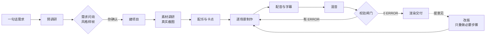

# promo-forge · 一句话做一支竖屏宣传片


**把产品名或网址丢给 AI 编程工具，它会自己调研、提问、出样帧让你挑、截真实界面、按拍卡点、配音配乐、逐项校验，最后交给你一支 1080×1920 的竖屏宣传片和一个能在浏览器里播放的网页版。**

写给抖音 / 小红书 / 视频号 / B站竖屏 / YouTube Shorts 这类**竖屏短视频**：30~60 秒、最晚第 4 秒完成第一次能量爆发、真实产品画面必须占主角。

**默认零付费**：配音用免费的 `edge-tts`，配乐用免费可商用曲库 + 本地节拍分析，渲染用 Remotion（个人与 3 人以内公司免费）。ElevenLabs 是可选升级项，不是必需品。

---

## 它解决什么问题

做一支像样的产品短视频，通常要：写脚本 → 找素材 → 定风格 → 截图 → 剪卡点 → 配音 → 混音 → 校验 → 导出。
外包一支几百到几千元；自己做要学一整套软件。

promo-forge 把这件事拆成两半：

- **给人看的部分**：`AGENTS.md` 是一份 AI 能照着执行的工作规范，`references/` 是每个阶段的方法论。
- **能跑的部分**：`template/` 是一个可直接复制的 Remotion 工程 + 一组独立脚本（截图、配乐分析、配音、混音、抽帧、校验）。

你只需要说一句话，然后在两个地方拍板：**需求确认**和**试听声音**。其余交给 AI。

## 和同类工具的区别

| | 常见做法 | promo-forge |
| --- | --- | --- |
| 画幅 | 横屏 16:9 优先 | **竖屏 1080×1920 优先**，含平台 UI 安全区（上 10% / 下 18% / 右 14%） |
| 配音 | 依赖付费 TTS API | **默认 edge-tts 免费本地配音**，ElevenLabs 可选 |
| 配乐 | 靠感觉挑一首 | 本地分析 BPM / beat / bar / downbeat / 逐小节能量，**卡点靠算不靠猜** |
| 画面 | AI 生成图凑 | **真实界面 2 倍图截图**（1080 宽画布需要 2160 像素），AI 图只做包装 |
| 质量 | 渲完就交 | 渲染前后各有**自动闸门**（缺文件、规格、响度、空档、渲染日志报错）+ 逐场景抽帧审图 |
| 证据 | 「渲染成功」就当看过 | **静帧证据闸门**：逐帧解码 PNG、量化空白（亮度方差）、像素尺寸==timing、帧时间戳覆盖每个场景；**转写反查闸门**：用户提供的转写逐行对齐字幕，漏念 / 错序 / 品牌名错字按阈值报 ERROR |
| 判断 | "感觉节奏太快/太慢" | 全部量化：快切 ≥0.5 秒、网址 ≥2.5 秒、人声高于音乐 ≥6 dB、母带 -14 LUFS |
| 交付 | 渲完就交 / 自动发布 | **发布合规检查单**（四平台标题/话题/正文/封面/安全区）+ 决策成本账本；只检查、**绝不自动发布** |

## 快速开始

### 前置条件

- **Node.js ≥ 18**、**Python ≥ 3.9**、**ffmpeg / ffprobe**（三样缺一不可）
- 可选：`ELEVENLABS_API_KEY`（想要更自然的音色再装）。把 `template/.env.example` 复制成**项目根**的 `.env` 再填 key；
  只有 `tts.py` / `doctor.py` 解析这份 `.env`，代理、镜像等设置要写成真实环境变量（PowerShell `$env:NAME=...`）才生效。

```bash
git clone https://github.com/hwy-miaomiao/promo-forge.git
cd promo-forge
pip install -r template/requirements.txt
python -m playwright install chromium   # Windows 上必须走 python -m
cd template && pnpm install && cd ..   # 没装 pnpm 用 npm install
python template/scripts/doctor.py     # 体检：只检查、不安装，缺什么给你装什么
```

### 用法一：克隆仓库直接用

用 Cursor / Claude Code / Codex 打开这个目录，然后说：

```text
帮我给 https://example.com 做一支竖屏宣传片
```

成片会落在 `outputs/<项目名>/`。

### 用法二：装成 Skill，在你自己的项目里用

```bash
npx skills add hwy-miaomiao/promo-forge    # 装到全局加 -g
```

装好后，在任意项目里说「给这个项目做一支宣传片」，AI 会自动调用；它能直接读你的源码和 README，拿到最准确的一手素材。成片落在当前项目的 `宣传片/` 目录（记得把它加进 `.gitignore`）。

### 一句话之后会发生什么

1. **AI 先自己调研**你的产品，再去查缺的信息。
2. **两轮提问**：画幅时长、目标受众、风格方向、开场方式、配音音色、素材与版权边界 —— 每题都带一个针对你产品的推荐项。
3. **出 3~4 张不同风格的样帧**给你挑（也可以混搭，比如"A 的配色 + C 的构图"）。选择写进 `需求确认.md`，你说"准确，开始制作"才开工。
4. 之后全自动：截图 → 配乐卡点 → 逐场景制作 → 配音 → 混音 → 校验 → 渲染 → 交付。
5. 中途只在三种情况找你：需要你登录某个网站、需要你试听配乐/音色、遇到只有你能核实的事实。

## 工作流程



改版时 AI 会判断影响范围：只换字幕就不动音频；只换音色就替换成片音轨而不重渲画面。

## 目录结构

```text
promo-forge/
├── AGENTS.md        # AI 工作规范（整个项目的核心，也是唯一权威）
├── SKILL.md         # 装成 Agent Skill 时的入口
├── CLAUDE.md        # 让 Claude Code 也读 AGENTS.md
├── references/      # 八份方法论：需求问询 / 风格方向 / 素材与截图 / 配乐与卡点 / 配音与字幕 / 校验清单 / 踩坑记录 / 案例复盘
├── template/        # 复制到项目里的 Remotion 工程模板
│   ├── src/         #   timing.json（唯一事实来源）+ Root/Promo + 组件 + 场景
│   ├── scripts/     #   doctor / capture / media / music / tts / mix / subtitles / fonts / deliver / audit / publish_check / frame_check / transcript_check / check_assets / check_video / stills / sync_template
│   ├── web/         #   基于 @remotion/player 的网页播放版
│   └── public/      #   素材与音频（截图、混音结果）
├── service/         # 可选的 MCP 服务化入口（零依赖 stdio server，把校验闸门暴露给外部编排器）
└── outputs/         # 克隆用法下的成片目录（git 忽略）
```

每个项目目录里除了成片，还会有 `需求确认.md`（你拍板的决定 + 每轮修改记录）、`调研笔记.md`（每个事实与素材的出处）、`timing.json`、抽帧校验图。

## 脚本速查

| 脚本 | 作用 |
| --- | --- |
| `scripts/doctor.py` | 环境体检：Node / ffmpeg / Python 包 / Playwright / 中文字体 / 配置，逐项给修复命令 |
| `scripts/capture.py` | Playwright 真实网页截图：设备预设、分段滚动、整页长图、隐藏弹窗、登录态复用，默认 2 倍图 |
| `scripts/media.py` | 素材整理：抓 Markdown 里的图、拼联系表、按实际裁切预览、限宽、列尺寸 |
| `scripts/music.py` | 配乐：BPM / beat / bar / downbeat / 逐小节能量分析、剪段、直链下载 |
| `scripts/tts.py` | 配音：免费 edge-tts（或 ElevenLabs）、多音色试听、时长与拖音审核、可选 STT 反查 |
| `scripts/mix.py` | 混音：人声归一化、ducking、转场音效、两遍 loudnorm 母带到 -14 LUFS；母带后响度复测失败直接 ERROR |
| `scripts/subtitles.py` | 字幕：导出 SRT / ASS（样式与画面一致），或把字幕烧进画面（软字幕可选） |
| `scripts/fonts.py` | 字体子集化：把片子里用到的字从系统字体抽成 300 KB 左右的子集并内嵌，换机器不缺字 |
| `scripts/deliver.py` | 交付：按抖音 / 小红书 / 视频号 / Shorts 预检规格（视频号的官方「建议值」只判 WARN），并出三张候选封面 |
| `scripts/check_assets.py` | 渲染前闸门：引用文件、图片尺寸、字体缺字、旁白窗口、`voice.lines` / `music.segments` 结构 |
| `scripts/check_video.py` | 成片闸门：规格、音轨（含是否覆盖全片）、响度、空档、渲染日志（编码 / 超时语义）+ 逐场景抽帧联系表 + 决策账本 |
| `scripts/audit.py` | 决策与成本账本：需求确认必填、付费服务逐项记账（含服务名）、默认 0 元预算（零付费）；超预算 / 缺记录 / 花钱未写服务名由闸门报 ERROR，存量项目缺账本只 WARN |
| `scripts/publish_check.py` | 四平台发布合规检查单：标题 / 话题 / 正文 / 时长 / 封面 / 字幕安全区 + 成片 MP4 容器校验（文本假视频直接 ERROR），输出 `publish/manifest.json`；只检查不发布。可选 `--frames <dir>` 把静帧证据并入检查单、`--transcript <file>` 把转写反查并入检查单 |
| `scripts/frame_check.py` | 静帧证据闸门（「代理真的看过画面」的机器可验证版）：完整解码 PNG（纯 stdlib zlib，不需要 Pillow）、量化空白帧（亮度方差）、像素尺寸==timing、帧时间戳覆盖每个场景；`--json` 输出 `{ok, frames, problems}` 供编排器消费，有 ERROR 非零退出 |
| `scripts/transcript_check.py` | 转写反查闸门（零依赖 STT 替代）：读用户提供的 txt 逐行或 SRT 转写，与 `timing.json` 的 `voice.lines`（或已生成 SRT）保序对齐，报漏念 / 多念 / 顺序错位 / 低相似度 / 品牌名或网址错字；`--min-coverage` / `--threshold` 可配，默认任一语音行漏配即 ERROR |
| `scripts/selftest.py` | 脚本纯函数自测总入口（CI 同款：12 个脚本的 `--selftest` + Python 3.9 写盘/API/BOM 兼容检查，共 15 项） |
| `scripts/stills.mjs` | 按秒或按场景抽帧（Remotion renderStill） |
| `scripts/sync_template.py` | 用新版模板更新已有项目（`--diff` / `--apply`；`--force` 连「本地比模板新」的文件也覆盖；`--help` 会列出同步范围与「未纳入比对」清单） |

`timing.json` 是整支片子的唯一事实来源：帧率、画幅、时长、场景窗口、beat/bar/drop、旁白逐句配置、品牌配色全在里面，TypeScript 与 Python 两侧共读它，改一处全链路生效。

## 本地自测与 CI

脚本里那些容易写错的纯函数逻辑（注释剥离、渲染日志强信号、时间/响度解析、字幕折行、版本解析等）有一组自测，不依赖素材、不需要 ffmpeg、不联网，一条命令全跑：

```bash
python template/scripts/selftest.py    # 12 个脚本的 --selftest + 3 项 Python 3.9 / 编码兼容检查（共 15 项）；全过退出码 0
```

每个脚本也能单独跑：`check_assets.py`、`check_video.py`、`audit.py`、`publish_check.py`、`frame_check.py`、`transcript_check.py`、`mix.py`、`subtitles.py`、`doctor.py`、`deliver.py`、`sync_template.py`、`media.py` 都支持 `--selftest`（例如 `python scripts/deliver.py --selftest`）。失败会打印 `ERROR: selftest — ...` 并以非零退出。

除 12 个脚本自测外，`selftest.py` 还会做三项 Python 3.9 / 编码兼容检查：① 真的导一次 `subtitles` 并写出一个 SRT（覆盖 `_write_srt` 写盘路径）；② 用 AST 扫描 `template/scripts` 与 `service/`、拒绝 `Path.write_text(..., newline=...)` 这类 3.10+ 参数（3.9 会抛 `TypeError`）；③ 源码 AST 扫描容忍 UTF-8 BOM（PowerShell 5.1 的 `Set-Content -Encoding utf8` 会写 BOM，合法脚本不能被误判红）。它们必须由 CI 的 3.9 格真正跑过才算数。

CI（`.github/workflows/ci.yml`）只做确定性检查，**不渲染、不跑 ffmpeg、不下载素材**：

- Python 3.9 / 3.12 矩阵：`compileall`（`template/scripts` + `service/`）+ `selftest.py` + 两个证据闸门单独 `--selftest`（`frame_check.py` 用自造 PNG 变体判「正常/空白/截断/CRC 坏/未知 critical chunk/tRNS 全透明/`--scale` 舍入」等，71 项断言；`transcript_check.py` 用构造转写判「一致/漏行/错序/品牌错字/`--ref srt` 品牌校验」，44 项断言，都不渲染、不联网）+ MCP 服务集成测试（44 项）+ 行尾必须 LF；
- Node 22：`npm install` + `tsc --noEmit`（只做类型检查）。

渲染、成片规格、响度、抽帧审图这些重活仍在本地按 AGENTS.md 第 7 节的闸门跑。

## 服务化入口（MCP，可选）

`service/` 把校验闸门暴露成一个**零依赖的 MCP stdio server**，方便 Cursor / Claude Code / n8n 等外部编排器直接调用，不用记脚本参数。它只做校验：不渲染、不联网、不登录平台、不替你发布。

```bash
python service/mcp_server.py             # JSON-RPC 2.0，按行 framing（一行一条 UTF-8 JSON）
python service/test_mcp_integration.py   # 零依赖集成测试（起子进程走 initialize / tools/list / tools/call；CI 同款）
```

五个工具：`check_assets`（渲染前闸门）、`check_video`（成片闸门）、`music_analyze`（BPM / beat / drop 分析）、`publish_check`（发布合规检查单）、`audit_validate`（决策/成本账本校验）。参数一律是项目路径与少量覆盖项，返回结构化 JSON（`exitCode` / `stats` / `structured` / 日志尾部）。工具 schema、请求示例、错误码与 Docker 说明见 [`service/README.md`](service/README.md)；Dockerfile 只装校验依赖，未在本机实测。

## 和 OpenMontage / MoneyPrinterTurbo 的分工

- **OpenMontage**（agent-first 的通用影视生产系统：多条 pipeline、700+ 技能/知识文件、60+ provider、Backlot 本地审片看板）：它更宽，覆盖纪录片 / 口播 / 动画 / 本地化等；promo-forge 更窄更深，只有「竖屏产品宣传片」一条路，但把竖屏安全区、真实界面 2 倍截图配额、母带 -14 LUFS、人声比音乐 ≥6 dB、节拍一致性 ≥0.9 这些**数值闸门**写死进脚本，0 ERROR 才交付。
- **MoneyPrinterTurbo**（主题/关键词 → 口播短视频：素材库 + TTS + 字幕 + 配乐）：它是「faceless 短视频」的默认入口；promo-forge 不拼素材库，主角是**真实产品界面**（Playwright 2 倍图截图），且交付前必须过发布合规检查单与决策成本账本。
- 共同点是产物都是 MP4；区别在「谁拍板」和「怎么判定合格」——promo-forge 只有三类事要人拍板（需求确认、试听声音、只有用户能核实的事实），其余交给量化脚本判定并自动出检查单。

## 常见问题

**需要花多少钱？** 项目本身免费。配音的免费路线（edge-tts）不花钱；配乐请从免费可商用曲库下载。唯一要留意的是 Remotion 的授权：个人和 3 人以内的公司免费，更大的团队需要购买公司授权（见 [Remotion 授权说明](https://www.remotion.dev/license)）。

**要做多久？** 大部分时间花在 AI 自己调研、制作与校验上；你需要参与的只有开头的问询和中途的试听。渲染时间取决于画面复杂度，1080×1920 通常在几分钟内。

**能用 Windows 吗？** 可以，本项目就是在 Windows 上开发验证的。脚本会自动选用微软雅黑 / Noto Sans CJK。macOS 与 Linux 同样支持。

**能做横版吗？** 可以。把 `timing.json` 的 `width/height/aspect` 改成 1920×1080 即可，组件按安全区自适应，同一套场景不破版。

**没有 ElevenLabs 能做吗？** 能。默认就是免费的 edge-tts，音色虽然不如付费的自然，但完全可用；也可以先用免费路线把片子做出来，之后再换成付费音色（只重做音频，不重渲画面）。

**可以只用其中一部分吗？** 可以。`template/` 是独立工程，截图、节拍分析、混音、成片检测这些脚本都能单独用。

**直接渲染出来的片子没有声音？** 模板里不含音频：`timing.json` 的 `music.file` 指向的文件由 `scripts/mix.py` 生成。
没混音时模板会自动静音渲染（不会报错），但 `check_assets.py`（渲染前）和 `check_video.py`（渲染后）都会把缺音轨报出来 ——
交片前先跑一次 `python scripts/mix.py`。

**换一台机器渲染出来是方块字 / 缺字？** 跑一次 `python scripts/fonts.py subset`：它把片子里真正用到的字
（示例工程约 341 字）从系统中文字体里抽出来，生成 300 KB 左右的子集字体放进 `public/fonts/`，渲染直接用这份字体，
换机器就不再依赖渲染机上装没装中文字体。子集字体**不入库**（字体授权 + 体积考虑，见 `.gitignore`），
所以克隆后要自己跑一次；它也是按当前文案生成的，**改了文案要重跑**，否则新字会变成方块。

**怎么把字幕烧进画面？** 平台不认软字幕、或者要发给别人直接看时：先
`npm run render:1080:nosubs` 渲一版**不带画面字幕**的成片，再
`python scripts/subtitles.py burn out/final-1080p-nosubs.mp4 -o out/final-1080p-hard.mp4`。
直接烧会把画面自带的字幕和烧进去的字幕叠成两行糊字。只要字幕文件的话用 `python scripts/subtitles.py srt`（SRT）或 `ass`（带样式）。

**怎么知道能不能投抖音 / 小红书？** `python scripts/deliver.py check out/final-1080p.mp4 --platform all`
会按平台报时长、画幅、帧率、码率、体积、音轨、响度。抖音和小红书的官方口径本项目抓不到，那几条标「需人工确认」——只提示、不参与判定，不会因此刷 WARN；
视频号那几条官方原文用「建议」的（码率 / 画幅）标「官方建议值（非硬限制）」只判 WARN，不是拒收门槛；标「本项目规范（AGENTS.md）」的才是我们自己的硬规矩（必须有音轨/视频流等）。
封面用 `python scripts/deliver.py cover out/final-1080p.mp4 --title "你的标题"` 一次出三张候选（1080×1920）+ 联系表，记得逐张看图；重跑时会先清掉上一轮本功能留下的 `cover-*.png` / `_{片子名}-frame-*.png`，不会误删其它文件（`<mp4>` 省略时脚本不报错，会静默套用默认值 `out/final-1080p.mp4`）。

**发布前最后一关怎么过？** 先 `python scripts/audit.py init` 建决策/成本账本，再补一条需求确认记录
`python scripts/audit.py append --kind user_requirement --decision "确认需求与风格"`（不补会被闸门报 ERROR），然后跑
`python scripts/publish_check.py --strict` —— 它按抖音 / 快手 / 小红书 / 视频号逐平台检查标题、话题、正文、时长、
封面数量与尺寸、字幕安全区，并校验成片是结构合法的 MP4（`ftyp`+`moov`；有 ffprobe 再验编码/时长/分辨率，
没有则显式 WARN），输出 `publish/manifest.json` 并给每平台 `publishable` 结论；0 ERROR 才投，
`--strict` 把 WARN 也当 ERROR（manifest 与退出码用同一份结果）。`deliver.py check` 0 ERROR 时也会自动生成这份检查单。
它**只检查、不登录、不自动发布**。被外部编排器调用时用 `service/mcp_server.py`（见上文「服务化入口」）。

**AI 说「我看过画面了」，怎么证明？** 让它跑 `python scripts/frame_check.py --project .`（默认读 `out/stills`）：它逐帧解码 PNG（纯 stdlib `zlib`，不依赖 Pillow）、量亮度方差判空白（全透明帧也算空白，含 `tRNS` 透明像素）、核对像素尺寸==timing、再按文件名时间戳核对每个场景是否都有帧；`--json` 输出 `{ok, frames, problems}` 给编排器，有 ERROR 非零退出。本机实测：ffmpeg 7.1 合成的 3 帧 540×960 测试图，正常帧亮度方差 4227.5 / 2107.1，纯白帧 0.0 被判 ERROR；`--selftest` 71 项断言在 Python 3.12 与 3.9 下都过。`deliver.py check` 默认接这项（没有 `out/stills` 只 WARN），`publish_check.py --frames out/stills` 可把证据并入发布检查单。

**配音真的和字幕对得上吗？** 把逐句转写（txt 每行一句，或 SRT）交给 `python scripts/transcript_check.py transcript.txt --project .`：它把转写与 `timing.json` 的 `voice.lines` 逐行对齐，默认**任一语音行没对上就是 ERROR**，覆盖率阈值 `--min-coverage`、相似度阈值 `--threshold` 可调；品牌名/网址要求逐字一致（错一个字就失败，对标 STT 反查的做法）。本机实测：模板 5 句旁白逐字转写 → 5 行相似度全 1.00、字符覆盖率 100%、0 ERROR；只念其中一句的转写 → 6 ERROR、覆盖率 2.94%。它不下载模型、不调付费 ASR，零依赖、可离线，所以 CI 里就能跑。

## 参与贡献

用了它做出满意的片子，欢迎在 Issue 里分享。踩到新坑，欢迎把「现象 / 原因 / 解决」补进 `references/踩坑记录.md` 并发 PR —— 下一个使用者的 AI 就会提前避开。

## 致谢

站在这些工具的肩膀上：[Remotion](https://www.remotion.dev)（渲染）、[edge-tts](https://github.com/rany2/edge-tts)（免费配音）、[ElevenLabs](https://elevenlabs.io)（可选配音与作曲）、[Playwright](https://playwright.dev)（截图）、[FFmpeg](https://ffmpeg.org)（音视频处理）、[Pillow](https://python-pillow.org) / [fontTools](https://fonttools.readthedocs.io)（图像与字体）。

思路上受到「把视频制作流程写成 AI 可执行规范」这一社区实践的启发（参考项目：[liyupi/ai-promo-video-maker](https://github.com/liyupi/ai-promo-video-maker)，本项目为独立实现，聚焦竖屏短视频与零付费路线）。

## 开源协议

[MIT](LICENSE)
